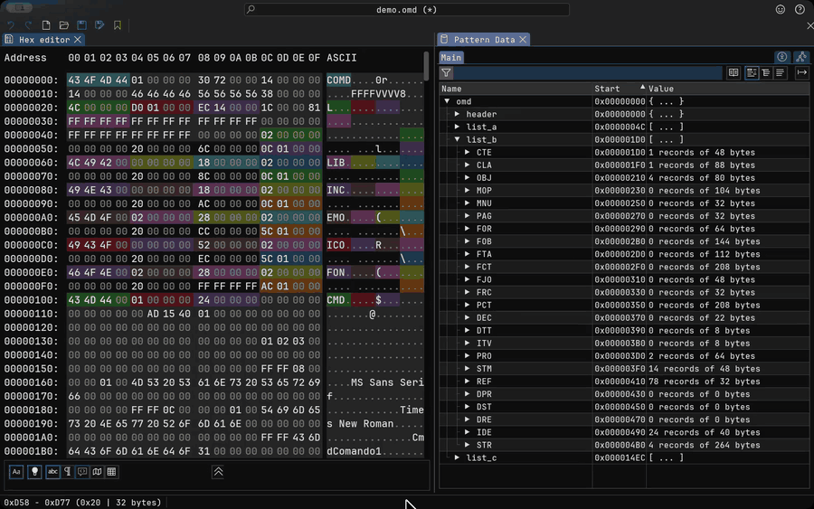
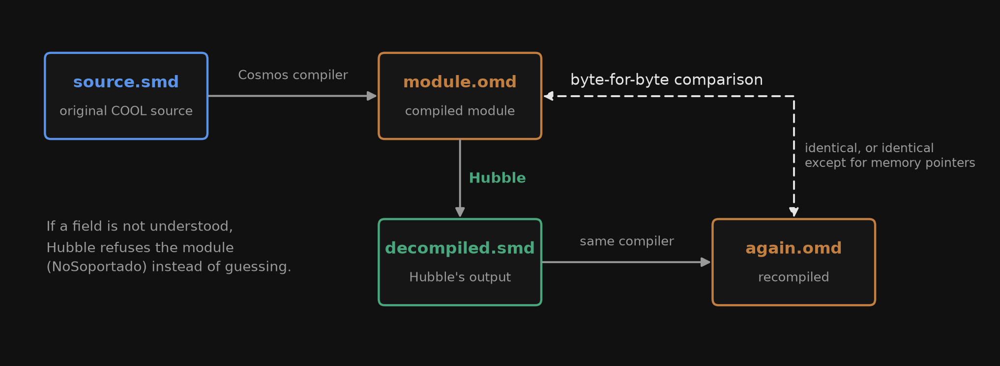
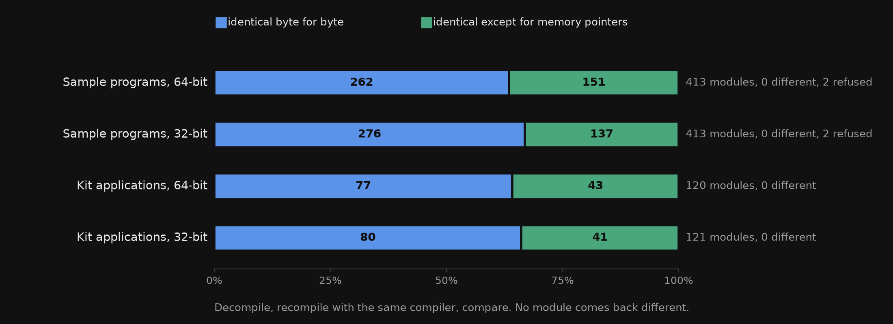
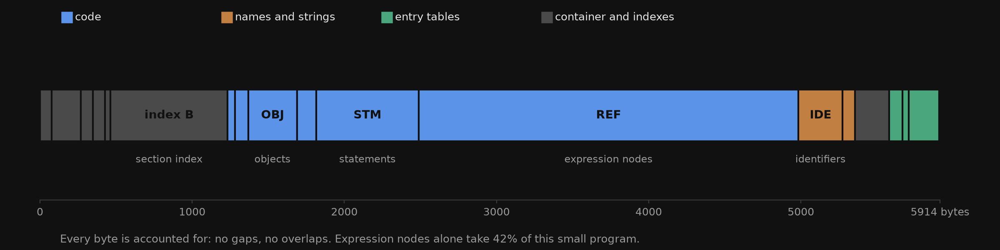

# Hubble

A decompiler for MultiBase Cosmos. It turns compiled `.omd` modules back into COOL source that the
Cosmos compiler accepts and that compiles to the same module, for 32-bit and 64-bit builds.

No public documentation of the `.omd` format or earlier tool for it could be found. The format was
worked out from the binaries alone, and every rule Hubble applies has been checked against bytes
produced by the real compiler.

This covers Cosmos 8.2 to 8.6 (format `0x7230`). An older format, `0x3211`, is read partially: there
is no compiler of that version to run the round trip, so its output is marked as unverified.



## How results are verified



A decompiled module only counts when it survives a round trip: decompile, recompile with the same
compiler, and compare the two modules byte for byte. When Hubble meets a field it has not verified,
it refuses the module with a reason (`NoSoportado`) instead of guessing.



| | |
|---|---|
| Sample programs of the evaluation kit | 413 of 415, in 64 and 32 bits (2 refused on purpose) |
| Applications shipped with the kit | every module decompiled, 0 different after the round trip |
| COOL vocabulary written by the decompiler | 234 of the 245 words in the compiler (5 do not compile in 8.6, 6 are not words) |
| Tests | 936, each new rule also checked by mutation |

## Usage

Requires Python 3.13 and [uv](https://docs.astral.sh/uv/). No runtime dependencies.

```sh
uv run hubble descompila module.omd              # COOL source to stdout
uv run hubble descompila -o out/ *.omd           # one .SMD per module (cp1252, CRLF)
uv run hubble secciones module.omd               # header and sections, with their size
uv run hubble textos module.omd                  # identifiers, strings and SVL, in order
```

Modules that use database tables need their repository: `--repositorio NAME` and `--dbs DIR`.

A short program and what comes back:

```
main
objects begin
    i as Integer
    texto as Char
end
begin
    for i = 1 to LIMITE do
    begin
        if i % 2 == 0 then
            texto = "par";
        else
            texto = "impar";
        (texto + ": " + Factorial(i).Char).Trace;
    end
end
```

## The format



A `.omd` is a container of 37 typed sections: code (classes, objects, statements, expression nodes),
names and strings, interface (forms, pages, controls, menus) and entry tables. The record layouts
differ between 32 and 64 bits and between Cosmos versions.

- [`docs/formato-omd.md`](docs/formato-omd.md): everything observed about the format, with the
  evidence for each field (in Spanish).
- [`imhex/omd.hexpat`](imhex/omd.hexpat): a pattern for [ImHex](https://imhex.werwolv.net/) that
  colours each section and decodes what Hubble understands; unknown bytes stay grey.

## Repository

| | |
|---|---|
| `src/hubble/` | container reader, decompiler, interface and repository readers, CLI |
| `tests/` | unit tests and corpus tests over the evaluation kits |
| `lab/` | the compiler under Wine in a container, the test batteries and the round trip |
| `imhex/` | ImHex pattern and its check against Hubble |
| `figures/` | scripts that draw the figures above (matplotlib; they also run in Google Colab) |

## Legal

Hubble is an independent project, not affiliated with or endorsed by Base 100. MultiBase and Cosmos
are names of their respective owners and are used here only to describe compatibility.

The repository contains no Base 100 software, no compiled modules and no source code from their kits.
To reproduce the results you need an evaluation kit obtained from Base 100. Hubble is meant for
studying the format and recovering the source of applications you are entitled to use.

## License

[GNU Affero General Public License v3.0](LICENSE).
